<div align="center">
  
</div>

<div align="center">
  <picture>
    <source media="(prefers-color-scheme: dark)" srcset="assets/tagline-dark.svg">
    <source media="(prefers-color-scheme: light)" srcset="assets/tagline-light.svg">
    
  </picture>
</div>

<p align="center">
  <a href="https://hits.sh/github.com/Nick-Prism/Nick-Prism/">
    
  </a>
</p>

---

## About Me

<table width="100%" border="0" cellspacing="0" cellpadding="0">
<tr>
<td width="58%" valign="top">

I'm drawn to problems that **don't have clean answers yet.**

Final year CS student at BMS College of Engineering (GPA: 9.31), building multi-agent AI systems, getting language models to coordinate, make decisions, and operate with real autonomy. I've shipped production AI systems at **QuickInsights** and **Samsung PRISM**, built multi-agent pipelines on **LangGraph + GCP**, fine-tuned models on **Vertex AI**, and designed **RAG pipelines** integrated with BigQuery and Neo4j.

My final-year project is a **hybrid-RAG Enterprise AI System** (Qdrant · Neo4j · PostgreSQL, with cross-encoder reranking), and I'm writing a **survey and a research paper** on enterprise AI systems.

I tend to test limits rather than accept them. Some of my best work came from ignoring what I was *supposed* to do.

Outside AI, I care about **cars & engines, graphic design, astronomy, and physics.**
*Whether it's a V10 or a Vector DB, I like understanding how things work.*

</td>
<td width="42%" align="center" valign="middle">
  <!-- To go back to the old animated GIF, replace the whole picture block below with:
        -->
  <picture>
    <source media="(prefers-color-scheme: dark)" srcset="assets/agents-dark.svg">
    <source media="(prefers-color-scheme: light)" srcset="assets/agents-light.svg">
    
  </picture>
</td>
</tr>
</table>

```python
alok = {
    "currently" : "Hybrid RAG, agentic architectures & an IEEE survey on enterprise AI",
    "open_to"   : "AI / ML roles & research internships",
    "motto"     : "Build systems that learn. Learn systems that matter."
}
```

---

## ⚙️ Tech Stack

<table width="100%">
  <tr>
    <td width="22%"><b>Languages</b></td>
    <td>
      
      
      
      
      
    </td>
  </tr>
  <tr>
    <td width="22%"><b>AI / ML</b></td>
    <td>
      
      
      
      
      
    </td>
  </tr>
  <tr>
    <td width="22%"><b>Data &amp; Retrieval</b></td>
    <td>
      
      
      
      
      
      
    </td>
  </tr>
  <tr>
    <td width="22%"><b>Backend &amp; Apps</b></td>
    <td>
      
      
      
      
    </td>
  </tr>
  <tr>
    <td width="22%"><b>Cloud &amp; Tools</b></td>
    <td>
      
      
      
      
    </td>
  </tr>
  <tr>
    <td width="22%"><b>Methods</b></td>
    <td>
      
      
      
      
      
      
      
    </td>
  </tr>
</table>

---

## 🔬 Research Interests

<table width="100%">
  <tr>
    <td align="center" width="33%">
      <b>🧠 Agentic Memory</b><br/>
      <sub>Persistent state, episodic & semantic memory for long-horizon agents</sub>
    </td>
    <td align="center" width="33%">
      <b>🤝 Multi-Agent Systems</b><br/>
      <sub>Coordination protocols, emergent behavior & cooperative reasoning</sub>
    </td>
    <td align="center" width="33%">
      <b>⚡ LLM Deployment at Scale</b><br/>
      <sub>Distributed inference, MLOps pipelines & serving infrastructure</sub>
    </td>
  </tr>
  <tr>
    <td align="center">
      <b>📊 RLHF & RLMF</b><br/>
      <sub>Reward modelling from human & market feedback, preference learning</sub>
    </td>
    <td align="center">
      <b>🔍 RAG + Knowledge Graphs</b><br/>
      <sub>Grounding LLMs in structured & unstructured knowledge</sub>
    </td>
    <td align="center">
      <b>🏗️ Agentic Architectures</b><br/>
      <sub>Tool use, planning, reflection loops & MCP integration</sub>
    </td>
  </tr>
</table>

---

## 📌 Projects

<details open>
<summary><b>🚀 Featured Work</b></summary>
<br>

| Project | Description | Stack | Status |
|---|---|---|---|
| 🤖 **Enterprise AI System** | Modular enterprise AI system for processing multimodal data through unified ingestion and retrieval pipelines; hybrid retrieval across structured, unstructured, and visual data (vector + BM25, graph, SQL) with cross-encoder reranking; scalable, maintainable components | Python · FastAPI · Next.js · Qdrant · Neo4j · PostgreSQL · LangGraph | 🔒 Private · 🔨 In Progress |
| 📈 **[Zeta](https://github.com/Nick-Prism/portfolio-manager)** | Distributed real-time stock market analysis; multi-agent HITL reasoning system with a council of experts for price prediction; Telegram bot for trade automation; custom MCP integration with Zerodha; RLMF for pattern recognition | Python · LangGraph · MCP · MongoDB · Docker · GCP | 🔨 In Progress |
| 📝 **IEEE Survey Paper** | *Enterprise AI Systems: A Comprehensive Survey of Foundational Architectures, Retrieval-Augmented Generation, and Multilingual Deployment* — multi-section survey paper | Literature survey · RAG · Multilingual LLMs | 📝 Drafting |
| 🌿 **[Plant Disease Detector](https://github.com/Nick-Prism/Plant_Disease_Detector)** | Multi-model CNN implementation for plant disease detection and classification; iterative hyperparameter tuning; 97.9% validation accuracy | TensorFlow · CNNs · Python · Streamlit | ✅ Public |
| 🎤 **[InterviewIQ](https://github.com/Nick-Prism/InterviewIQ)** | AI-powered interview simulation with automated evaluation pipelines; scoring logic across multiple dimensions with structured feedback generation; built in a 6-hour college hackathon | Python · Streamlit · APIs | ✅ Shipped |
| 🏗️ **[Agent Architects Studio](https://github.com/Nick-Prism/agent-architects-studio)** | Experimental multi-agent architecture studio | Python | ✅ Public |
| 🧪 **[Research Agent (AutoGen)](https://github.com/Nick-Prism/researchagent_autogen)** | Autonomous multi-agent research pipeline using AutoGen; agent coordination and task decomposition | Python · AutoGen · LLMs | ✅ Public |
</details>

<details>
<summary><b>💼 Professional Experience</b></summary>
<br>

**AI Intern — QuickInsights.ai** *(Nov 2025 – May 2026 · Remote)*
- Implemented Multi-Agent LangGraph pipeline to convert Natural Language to BigQuery for Dashboard and Report Generation
- Built data processing pipelines for large-scale performance analysis on cloud infrastructure
- Designed AI workflows that automated parts of the system, cutting manual effort by **~45%**

**R&D Intern — Samsung R&D Institute India (Samsung PRISM)** *(Jul 2025 – Mar 2026 · Bengaluru)*
- Built a rich labelled dataset of **10K+ webpages and articles** for content extraction
- Trained an **XGBoost model** for node detection and classification with Random Forest ensembling
- Followed an iterative approach for model optimization, improving classification logic
- Bundled the project as a browser extension with cascading 3-tier logic; built a reader mode outperforming existing solutions

</details>

---

## 🏆 Certifications & Achievements

- 🎖️ **Oracle Generative AI Professional** — Oracle (Aug 2025)
- 🤖 **Applied Generative AI** — Infosys Springboard (Jan 2025)
- 🧠 **AI-first Software Engineering** — Infosys Springboard (Jan 2025)
- 💬 **Introduction to NLP** — Infosys Springboard (Nov 2025)
- 🔧 **Prompt Engineering** — Infosys Springboard (Jan 2025)
- ☁️ **Google Cloud Skills Boost** Badges (2024)
- 🥇 Quarter Finalist — **CodeSphere** National Level Codeathon @ BMSCE
- 🥇 Quarter Finalist — **Xcel Hackathon** @ BMSCE

---

## 🌱 Currently Exploring

```
[ ████████░░ ] Agentic Memory Systems & Long-horizon Planning
[ ███████░░░ ] RLHF / RLMF — Reward Modelling from Human & Market Feedback
[ ██████░░░░ ] Distributed LLM Inference & Serving at Scale
[ █████░░░░░ ] MCP Protocol & Tool-augmented Agent Design
```

---

## 🐍 Contribution Graph

<div align="center">
  <picture>
    <source media="(prefers-color-scheme: dark)" srcset="https://raw.githubusercontent.com/Nick-Prism/Nick-Prism/output/github-contribution-grid-snake-dark.svg">
    <source media="(prefers-color-scheme: light)" srcset="https://raw.githubusercontent.com/Nick-Prism/Nick-Prism/output/github-contribution-grid-snake.svg">
    
  </picture>
</div>

---

## 📬 Find Me

<p align="center">
  <a href="https://github.com/Nick-Prism">
    
  </a>
  <a href="mailto:alok.cs23@bmsce.ac.in">
    
  </a>
  <a href="https://www.linkedin.com/in/alok-aeri-b3b1122b5/">
    
  </a>
</p>

---

<div align="center">
  
</div>

<div align="center">
  <sub><i>"Build systems that learn. Learn systems that matter."</i></sub>
</div>
